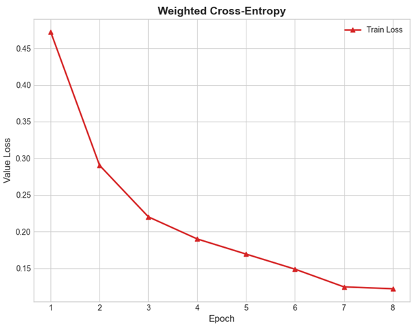
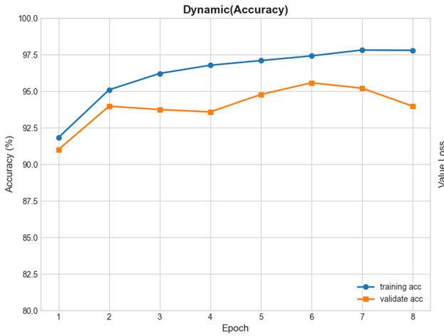
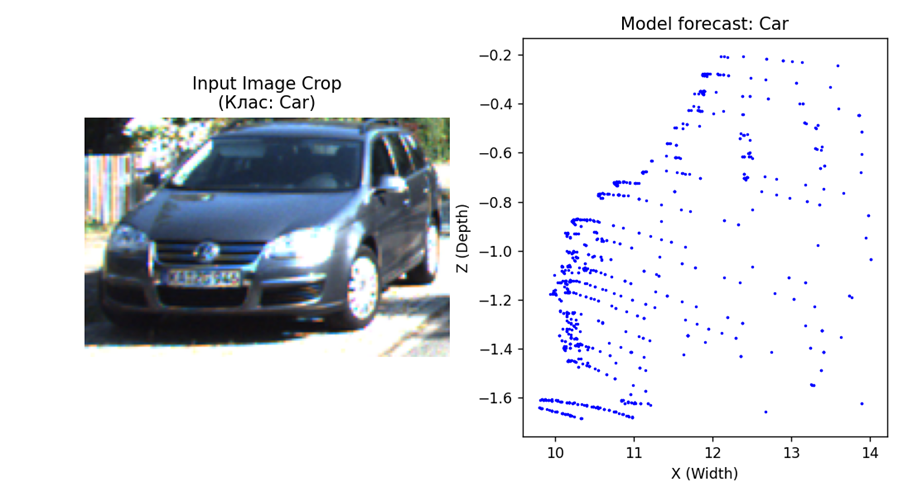

# Мультимодальний аналіз сцени на основі LiDAR та IR-відео з використанням трансформерних архітектур

Магістерський проєкт: програмна система класифікації об'єктів сцени (**Car / Pedestrian / Cyclist**)
за спільними даними LiDAR та камери (RGB/IR) з використанням Transformer Encoder із
**проміжним злиттям ознак (Intermediate Fusion)** та роботою в реальному часі на бортовому
пристрої (NVIDIA Jetson Orin) через ROS 2.

| Параметр | Значення |
| :--- | :--- |
| Автор | Яремків Р.М., група ФеІМ-12 |
| Керівник | ас. Марчук Ю.Б. |
| Мова | Python 3.10+ |
| Основні технології | PyTorch, ROS 2 (Humble/Jazzy), TensorRT / ONNX, NumPy/SciPy, OpenCV |
| Датасет | KITTI Object Detection (image_2, velodyne, calib, label_2) |

## Можливості

| ID | Вимога | Реалізація |
| :-- | :-- | :-- |
| FR-01 | Синхронізація та калібрування (похибка < 2 px) | `src/utils/calibration.py` — єдиний модуль проєкції; тести `tests/test_geometry_calibration.py` |
| FR-02 | LiDAR-кропінг за орієнтованим 3D-боксом | `src/utils/geometry.py` (`OrientedBox`, деротація для довільного кута), `src/data_pipeline/lidar_cropper.py` |
| FR-03 | Нормалізація хмари до `[1024, 4]` | `src/data_pipeline/normalization.py` (`PointCloudNormalizer`) |
| FR-04 | Класифікація з імовірністю | `src/model/fusion_transformer.py`, `src/model/inference_engine.py` |
| FR-05 | 3D SLAM-карта | FAST-LIO2 (зовнішній пакет ROS 2), запускається з launch-файлу |
| FR-06 | Публікація в ROS 2 і RViz2 | `/detected_objects` (`vision_msgs/Detection3DArray`) + маркери, `config/rviz/scene_analysis.rviz` |
| NFR-01/02 | ≥ 20 FPS, TensorRT FP16 | `src/model/export.py`, бекенд `tensorrt`, статистика FPS у вузлі інференсу |
| NFR-03 | F1 ≥ 88 % | macro F1 у `src/training/metrics.py`, вибір чекпойнта за macro F1 |
| NFR-05 | Стійкість до втрати камери | маскування токенів зображення + modality dropout під час навчання; оцінка «LiDAR-only» у `evaluate.py` |

## Архітектура моделі

```
image patch 224x224 ──► ResNet-18 (frozen) ──► 7x7x512 ──► Linear ──► 49 image tokens ─┐
                                                                                      ├─► [CLS | img | pts] + modality emb.
object points [1024,4] ──► shared MLP (4→64→128) ──────────────────► 1024 point tokens ┘            │
                                                                                                    ▼
                                                     Transformer Encoder (3 шари, 8 голів, d=128, маска для відсутньої камери)
                                                                                                    │
                                                                                     CLS ──► MLP ──► Car / Pedestrian / Cyclist
```

Детальніше: [docs/architecture.md](docs/architecture.md).

## Структура проєкту

```
multimodal-lidar-ir-transformer/
├── src/                       # імпортується як пакет `multimodal_transformer`
│   ├── data_pipeline/         # читання KITTI, OBB-кропінг, нормалізація, ROI extraction, датасет
│   ├── model/                 # Transformer (Intermediate Fusion), експорт ONNX/TensorRT, бекенди інференсу, демо
│   ├── training/              # цикл навчання, зважена функція втрат, метрики, оцінка
│   ├── ros2_nodes/            # вузли ROS 2: ROI extraction, інференс/публікація, програвач KITTI; launch/
│   └── utils/                 # калібрування, геометрія OBB, конфігурація, журнал детекцій (SQLite)
├── tests/                     # модульні та інтеграційні тести (pytest)
├── config/                    # dataset / model / train / ros2_pipeline / calibration *.yaml, rviz
├── docs/                      # технічна документація
├── pyproject.toml
└── requirements.txt
```

## Встановлення

```bash
git clone https://github.com/Astrisl/Multimodal-Transformer-KiTTi.git multimodal-lidar-ir-transformer
cd multimodal-lidar-ir-transformer
python3 -m venv .venv && source .venv/bin/activate
pip install -r requirements.txt
pip install -e .            # робить `src/` доступним як `multimodal_transformer`
pre-commit install          # black + flake8 перед кожним комітом
```

Розгортання на Jetson Orin (JetPack, ROS 2, FAST-LIO2, TensorRT): [docs/deployment_jetson.md](docs/deployment_jetson.md).

## Відтворення експерименту

1. **Дані.** Завантажте KITTI Object Detection (left color images, Velodyne, calibration, labels)
   і розпакуйте у `$KITTI_ROOT/training/{image_2,velodyne,calib,label_2}`.
   ```bash
   export KITTI_ROOT=/data/kitti
   ```
2. **Підготовка кропів** (RGB-патч + LiDAR-точки в OBB для кожного об'єкта, `index.csv`):
   ```bash
   python -m multimodal_transformer.data_pipeline.build_dataset --config dataset.yaml
   ```
3. **Навчання** (найкращий чекпойнт за macro F1 → `runs/default/best.pth`, історія → `training_history.json`):
   ```bash
   python -m multimodal_transformer.training.train --dataset dataset.yaml --model model.yaml --train train.yaml
   ```
4. **Оцінка** (accuracy, F1 по класах, LiDAR-only режим, затримка):
   ```bash
   python -m multimodal_transformer.training.evaluate --checkpoint runs/default/best.pth --output report.json
   ```
5. **Візуальне демо** на кадрі KITTI:
   ```bash
   python -m multimodal_transformer.model.demo --checkpoint runs/default/best.pth --save demo.png
   ```
6. **Експорт для Edge** (на Jetson):
   ```bash
   python -m multimodal_transformer.model.export --checkpoint runs/default/best.pth --onnx model.onnx
   python -m multimodal_transformer.model.export --onnx model.onnx --engine model.engine --fp16
   ```
7. **Клас Background** (фон для живого конвеєра). Екстрактор кандидатів знаходить і стовпи,
   бордюри, кущі; модель на 3 класи впевнено називала б їх Car / Pedestrian. Тим самим
   екстрактором збираються негативні приклади з кадрів KITTI, і модель донавчається з 4 класами:
   ```bash
   python -m multimodal_transformer.data_pipeline.mine_background --config dataset.yaml
   python -m multimodal_transformer.training.train --dataset dataset_background.yaml --model model.yaml --train train_background.yaml
   ```
8. **Перевірка на реальній поїздці** KITTI raw (безперервний запис, напр. `2011_09_26_drive_0009`:
   `*_sync.zip`, `*_tracklets.zip` і `2011_09_26_calib.zip` з сайту KITTI). Той самий конвеєр,
   що й вузли ROS 2, без ROS: час етапів, звірка з розміткою, відео (камера + вид зверху):
   ```bash
   python -m multimodal_transformer.training.drive_demo --drive data/kitti_raw/2011_09_26/2011_09_26_drive_0009_sync
   ```
9. **Реальний час (ROS 2)**:
   ```bash
   # поїздка KITTI raw: автомобіль їде сценою в RViz2 (TF world -> lidar з GPS/IMU)
   ros2 launch src/ros2_nodes/launch/scene_analysis.launch.py        kitti_raw_dir:=data/kitti_raw/2011_09_26/2011_09_26_drive_0009_sync        rviz_config:=config/rviz/kitti_drive.rviz use_slam:=false
   # окремі кадри KITTI Object замість сенсорів
   ros2 launch src/ros2_nodes/launch/scene_analysis.launch.py kitti_split_dir:=$KITTI_ROOT/training use_slam:=false
   # живі сенсори + FAST-LIO2
   ros2 launch src/ros2_nodes/launch/scene_analysis.launch.py fast_lio_config:=mid360.yaml
   ```

Усі параметри описані в [docs/configuration.md](docs/configuration.md), топіки й повідомлення — у
[docs/ros2_api.md](docs/ros2_api.md).

## Тестування та стиль коду

```bash
pytest                 # 44 тести: проєкція, OBB, нормалізація, датасет, ROI, модель, ONNX, навчання, журнал
black --check src tests
flake8 src tests
```

Тести не потребують KITTI: `tests/conftest.py` генерує синтетичний датасет у форматі KITTI
з реальною калібровкою кадру 000000.

## Результати версії 1

Попередня версія (плоскі скрипти) досягла піку validation accuracy 95.57 % на KITTI
(GTX 1650, 25–30 мс на об'єкт). Графіки збіжності та приклад візуалізації:

| Loss | Accuracy | Класифікація |
| :-: | :-: | :-: |
|  |  |  |

Відмінності версії 2 і виправлені дефекти: [docs/changes_from_v1.md](docs/changes_from_v1.md).
Метрики v2 (macro F1, LiDAR-only) слід отримати повторним запуском кроків 2–4.

## Робота з Git

`main` — стабільна версія, `develop` — інтеграція, `feature/*` — окремі модулі, `fix/*` — виправлення.
Коміти — Conventional Commits (`feat:`, `fix:`, `docs:`, `refactor:`, `test:`), один коміт — одна логічна зміна.

## Джерела

* Geiger A., Lenz P., Urtasun R. Are we ready for Autonomous Driving? The KITTI Vision Benchmark Suite. CVPR, 2012.
* Vaswani A. et al. Attention Is All You Need. NeurIPS, 2017.
* Qi C.R. et al. PointNet: Deep Learning on Point Sets for 3D Classification and Segmentation. CVPR, 2017.
* Xu W. et al. FAST-LIO2: Fast Direct LiDAR-Inertial Odometry. IEEE T-RO, 2022.
* He K. et al. Deep Residual Learning for Image Recognition. CVPR, 2016.
* Paszke A. et al. PyTorch: An Imperative Style, High-Performance Deep Learning Library. NeurIPS, 2019.
