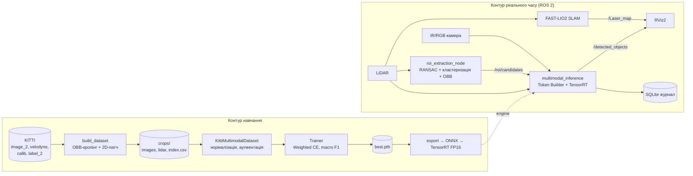
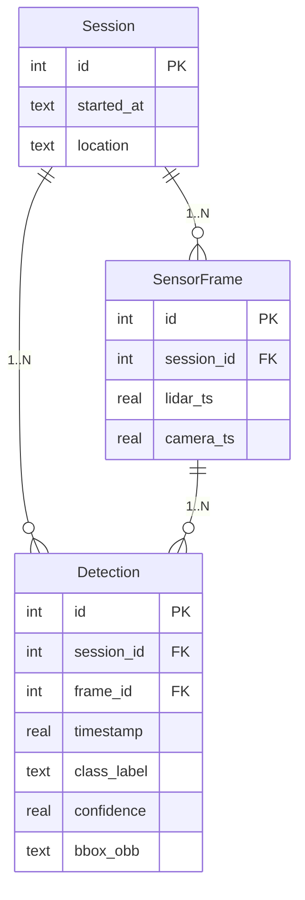

# Архітектура системи

## 1. Два контури

Система складається з **офлайн-контуру навчання** та **контуру реального часу** (event-driven,
публікація/підписка ROS 2). Обидва контури використовують *той самий* код попередньої обробки
(`data_pipeline`, `utils`), тому вхід моделі під час навчання та під час роботи «наживо» ідентичний.



## 2. Послідовність обробки кадру

```mermaid
sequenceDiagram
  participant L as LiDAR
  participant C as Камера
  participant R as ROI Extraction
  participant I as Inference
  participant V as RViz2
  L->>R: PointCloud2 (t)
  L->>I: PointCloud2 (t)
  C->>I: Image (t')  (буфер останніх кадрів)
  R->>I: Detection3DArray кандидатів (t)
  Note over I: точна пара (скан, кандидати) за t;<br/>найближчий кадр камери, |t - t'| ≤ max_sync_dt
  I->>I: кроп точок в OBB, проєкція OBB → 2D-патч,<br/>нормалізація [1024,4], батч → TensorRT
  I->>V: /detected_objects + маркери
```

Якщо кадр камери відсутній, розсинхронізований або занадто темний — об'єкти класифікуються
лише за LiDAR (токени зображення маскуються), кадр не відкидається (NFR-05).

## 3. Модель

| Блок | Вхід → вихід | Примітки |
| :-- | :-- | :-- |
| ImageEncoder | `[B,3,224,224]` → `[B,49,128]` | ResNet-18 ImageNet без avgpool/fc, ваги та BatchNorm заморожені |
| PointEncoder | `[B,1024,4]` → `[B,1024,128]` | спільний MLP 4→64→128 (PointNet-стиль), без позиційного кодування — хмара є множиною |
| Modality embedding | +`e_img` / +`e_lidar` | дозволяє self-attention розрізняти модальності |
| CLS token | `[B,1,128]` | агрегує злите представлення |
| Transformer Encoder | `[B,1074,128]` | 3 шари, 8 голів, FF 256, pre-norm, `src_key_padding_mask` для зображення |
| Head | CLS → `[B,3]` | LayerNorm → Linear 128→64 → GELU → Dropout → Linear 64→3 |

**Чому Intermediate Fusion.** Early Fusion (злиття сирих даних) чутливе до шуму та похибок
калібрування; Late Fusion (злиття окремих прогнозів) не бачить взаємозв'язків між модальностями.
Тут кожен шар self-attention дозволяє токенам зображення та точкам «дивитися» один на одного,
тож мережа сама зважує внесок модальностей.

**Modality dropout.** Під час навчання для 20 % зразків токени зображення маскуються, тому
мережа вчиться також LiDAR-only класифікації; маскування через `key_padding_mask` гарантує, що
вміст «відсутнього» зображення не впливає на вихід (перевірено тестом).

**Зважена функція втрат.** `L = -Σ w[y_i]·log p(y_i|x_i) / Σ w[y_i]`, ваги `[1, 5, 10]`
(або `auto` = √ оберненої частоти) компенсують домінування класу Car.

## 4. Проєктування даних

Тензори моделі на кожен об'єкт: точки `[1024, 4]` (x, y, z, інтенсивність, центровано на
центроїді) і патч зображення `[3, 224, 224]`, плюс прапорець `image_valid`.

Журнал детекцій (SQLite, `src/utils/detection_log.py`):



`bbox_obb` — JSON `{"center": [x,y,z], "size": [l,w,h], "yaw": a}` у системі LiDAR.
Запис виконується фоновим потоком, тому диск не блокує ROS-колбек.

## 5. Системи координат

| Система | Осі | Де використовується |
| :-- | :-- | :-- |
| LiDAR (Velodyne) | x вперед, y вліво, z вгору | сирі скани, вхід моделі, OBB live-пайплайну |
| Rectified camera | x вправо, y вниз, z вперед | мітки KITTI (`location`, `ry` навколо Y) |
| Image | u вправо, v вниз (пікселі) | 2D-патчі |

Перехід: `x_rect = R0_rect · Tr_velo_to_cam · x_velo`, `uv = P2 · x_rect` (`utils/calibration.py`).
Бокс KITTI: центр = `location − (0, h/2, 0)`, точка в системі бокса `p_local = Rᵀ(p − c)`
(`utils/geometry.py`).

## 6. Принципи коду

* **Separation of Concerns** — алгоритми (`data_pipeline`, `model`) не залежать від ROS; ROS-вузли лише адаптують повідомлення.
* **DRY** — проєкція, OBB, нормалізація і побудова токенів існують в одному місці та спільні для навчання й real-time.
* **SRP** — `PointCloudNormalizer`, `RoiExtractor`, `MultimodalSampleBuilder`, `ObjectClassifier`, `DetectionJournal` мають одну відповідальність.
* **Слабке зв'язування** — вузли спілкуються тільки топіками стандартних типів (`vision_msgs`, `visualization_msgs`).
* **Конфігурація** — усі гіперпараметри, шляхи та топіки в `config/*.yaml`; шляхи через змінні оточення.
